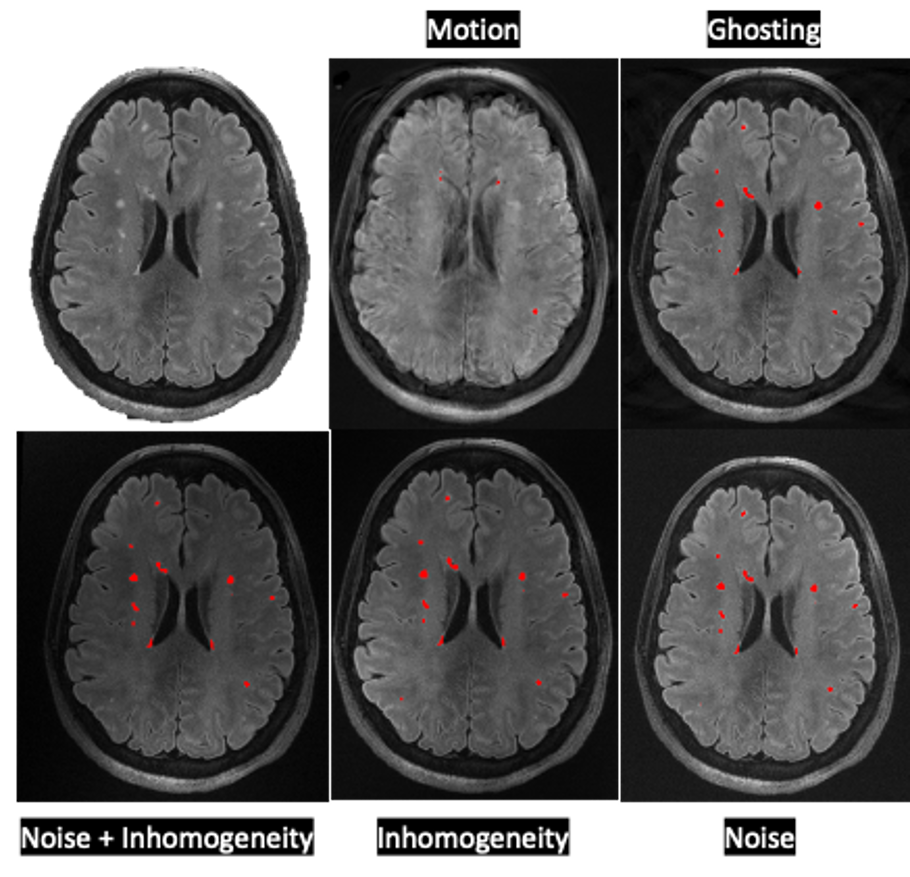
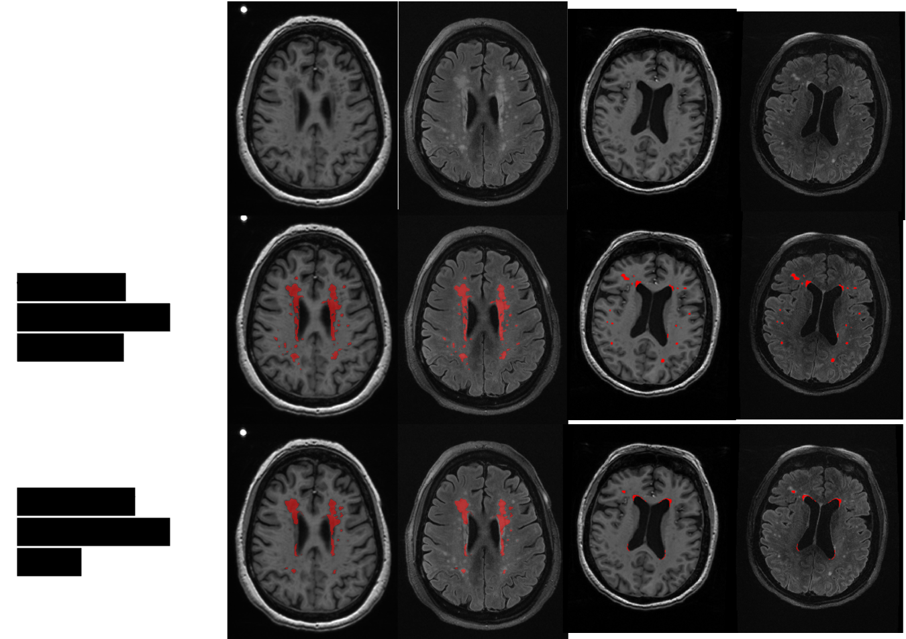
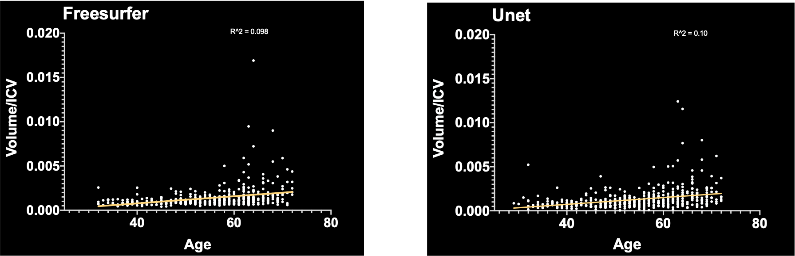

# wmh_seg
An automatic white matter lesion / hyperintensity segmentation tool.

`wmh_seg` runs nnU-Net v2 models that each take a **single input image of any
one contrast** (FLAIR, T1, T2 or GRE) — feed whatever you have. nnU-Net handles
preprocessing (normalization, resampling, sliding-window inference) and writes
the prediction back in your input's geometry, so no manual preprocessing is
needed. Pick a model with a flag:

| Flag | Trained on |
|------|------------|
| `--invivo` *(default)*  | in-vivo 1.5T, 3T, 7T (T1w MPRAGE, T2w FLAIR) |
| `--exvivo` | ex-vivo 7T (MP2RAGE, T2wSPC, GRE) |
| `--unified` | both in-vivo and ex-vivo (contrast-agnostic generalist) |
| `--invivo --legacy` | the original FLAIR model (kept for compatibility) |

Each nnU-Net model is a `3d_fullres` 5-fold ensemble. The legacy transformer was
trained on more than 300 FLAIR scans at 1.5T, 3T and 7T from the University of
Pittsburgh, UMC Utrecht, NUHS Singapore, and VU Amsterdam, with
[torchio](https://torchio.readthedocs.io/transforms/transforms.html) data
augmentation, and shows reliable results on par with FreeSurfer.

<p align="center">



</p>

## Installation
```bash
pip install wmh_seg
```
GPU (CUDA/MPS) is used automatically if available, otherwise falls back to CPU.
nnU-Net inference is much faster on a GPU; the 5-fold ensemble is slow on CPU
(use `--folds 0` to run a single fold if needed).

GPU memory: inference peaks at about 3 GB for a 0.37 mm ex-vivo T1 of
228 x 514 x 400 voxels, so an 8 GB card is enough. On that volume with an
RTX 5070 the full 5-fold ensemble with test-time mirroring takes about 5 min;
`--folds 0 --no-mirroring` takes about 12 s and agrees with the full ensemble
at a Dice of 0.93.

The first run of a given model downloads its 5 fold checkpoints (~1.2 GB total)
from [Hugging Face](https://huggingface.co/jil202/wmh_seg) and caches them in
`~/.cache/wmh_seg`. To use a local nnU-Net model folder instead (and skip the
download), set the model's env var to a folder containing `dataset.json`,
`plans.json`, and `fold_<i>/checkpoint_final.pth`:
`WMH_SEG_INVIVO_DIR`, `WMH_SEG_EXVIVO_DIR`, or `WMH_SEG_UNIFIED_DIR`.

---

## CLI Usage

### Basic WMH segmentation
```bash
# In-vivo (default) — also the bare command with no model flag
wmh_seg -i invivo.nii.gz -o wmh.nii.gz --invivo -v

# Ex-vivo
wmh_seg -i exvivo.nii.gz -o wmh.nii.gz --exvivo -v

# Unified generalist (handles either in-vivo or ex-vivo)
wmh_seg -i scan.nii.gz   -o wmh.nii.gz --unified -v

# Legacy in-vivo transformer model
wmh_seg -i invivo.nii.gz -o wmh.nii.gz --invivo --legacy -v

# Speed knobs: a single fold instead of the 5-fold ensemble, no test-time
# mirroring, optional compile
wmh_seg -i scan.nii.gz -o wmh.nii.gz --folds 0
wmh_seg -i scan.nii.gz -o wmh.nii.gz --folds 0 --no-mirroring
wmh_seg -i scan.nii.gz -o wmh.nii.gz --compile -v
```
Every input is reoriented to canonical **RAS** before inference and the mask is
mapped back to the input's original orientation, so results don't depend on how
the image was stored on disk. Pass `--no-reorient` to skip this.

### All options
| Flag | Description |
|------|-------------|
| `-i`, `--input` | Input NIfTI path (`.nii` / `.nii.gz`) |
| `-o`, `--output` | Output segmentation NIfTI path |
| `--invivo` | Dedicated in-vivo nnU-Net model (**default**) |
| `--exvivo` | Dedicated ex-vivo nnU-Net model |
| `--unified` | Unified contrast-agnostic nnU-Net model |
| `--legacy` | Legacy in-vivo transformer model (only valid with `--invivo`) |
| `-f`, `--folds N [N ...]` | nnU-Net fold(s) to ensemble (default: all 5) |
| `--no-mirroring` | Skip test-time mirroring (the 8 axis flips of every patch): ~8x faster, slightly less accurate |
| `--compile` | `torch.compile` the model (slower first call, faster afterwards) |
| `--no-reorient` | Skip RAS reorientation (infer in the input's stored orientation) |
| `-v`, `--verbose` | Show progress bar |
| `-b`, `--batch N` | *(legacy)* Batch size for the transformer model (default: 4) |
| `--fast` | *(legacy)* Axial-only inference (faster, slightly less accurate) |

`--invivo`, `--exvivo`, and `--unified` are mutually exclusive. `--legacy` only
applies to the in-vivo model (`--legacy` on its own is equivalent to
`--invivo --legacy`, since in-vivo is the default).

### Batch processing with GNU parallel
```bash
ls *.nii.gz | parallel --jobs 4 wmh_seg -i {} -o {.}_wmh.nii.gz -v
```

---

## Python API

### nnU-Net models (file in, file out)
nnU-Net reads/writes NIfTI itself (to preserve spacing & geometry), so this
entry point is path-based:
```python
from wmh_seg import nnunet_segment

# model='invivo' (default) | 'exvivo' | 'unified'; folds=None uses all 5
nnunet_segment('scan.nii.gz', 'scan_wmh.nii.gz', verbose=True)
nnunet_segment('scan.nii.gz', 'scan_wmh.nii.gz', model='exvivo')
nnunet_segment('scan.nii.gz', 'scan_wmh.nii.gz', model='unified', folds=[0], compile=True)
nnunet_segment('scan.nii.gz', 'scan_wmh.nii.gz', model='exvivo', folds=[0], mirroring=False)  # fastest
```
Inputs are reoriented to RAS before inference and the mask is mapped back to the
input's orientation; pass `reorient=False` to disable.

### Legacy in-vivo transformer model (in-memory array)
```python
import nibabel as nib
from wmh_seg import wmh_seg

img = nib.load('FLAIR.nii.gz')
seg = wmh_seg(img, verbose=True, fast=True, batch=4)   # mode='wmh' (legacy in-vivo)
nib.save(nib.Nifti1Image(seg, affine=img.affine), 'output_wmh.nii.gz')
```

### `wmh_seg()` parameters (legacy transformer model)
| Parameter | Type | Default | Description |
|-----------|------|---------|-------------|
| `img_orig` | `Nifti1Image` or `np.ndarray` | — | Input FLAIR image |
| `mode` | `'wmh'` | `'wmh'` | Legacy in-vivo transformer |
| `verbose` | `bool` | `True` | Show progress bar |
| `fast` | `bool` | `True` | Axial-only inference |
| `batch` | `int` | `4` | Inference batch size |

---

## Citation
If you find this useful for your research, please cite:
```bibtex
@article{li2024wmh_seg,
  title={wmh\_seg: Transformer based U-Net for Robust and Automatic White Matter Hyperintensity Segmentation across 1.5 T, 3T and 7T},
  author={Li, Jinghang and Santini, Tales and Huang, Yuanzhe and Mettenburg, Joseph M and Ibrahim, Tamer S and Aizenstein, Howard J and Wu, Minjie},
  journal={arXiv preprint arXiv:2402.12701},
  year={2024}
}
```
